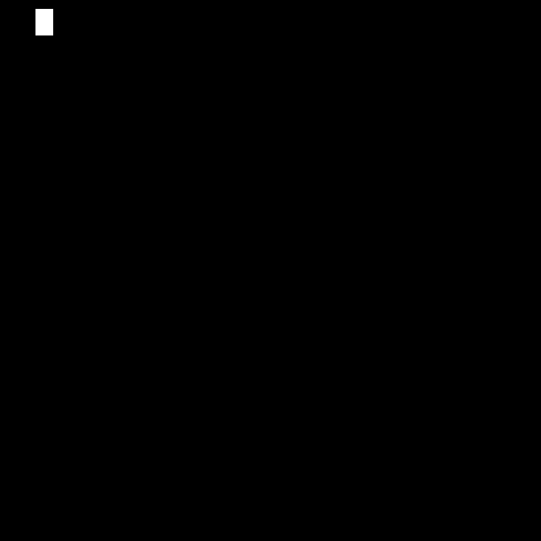
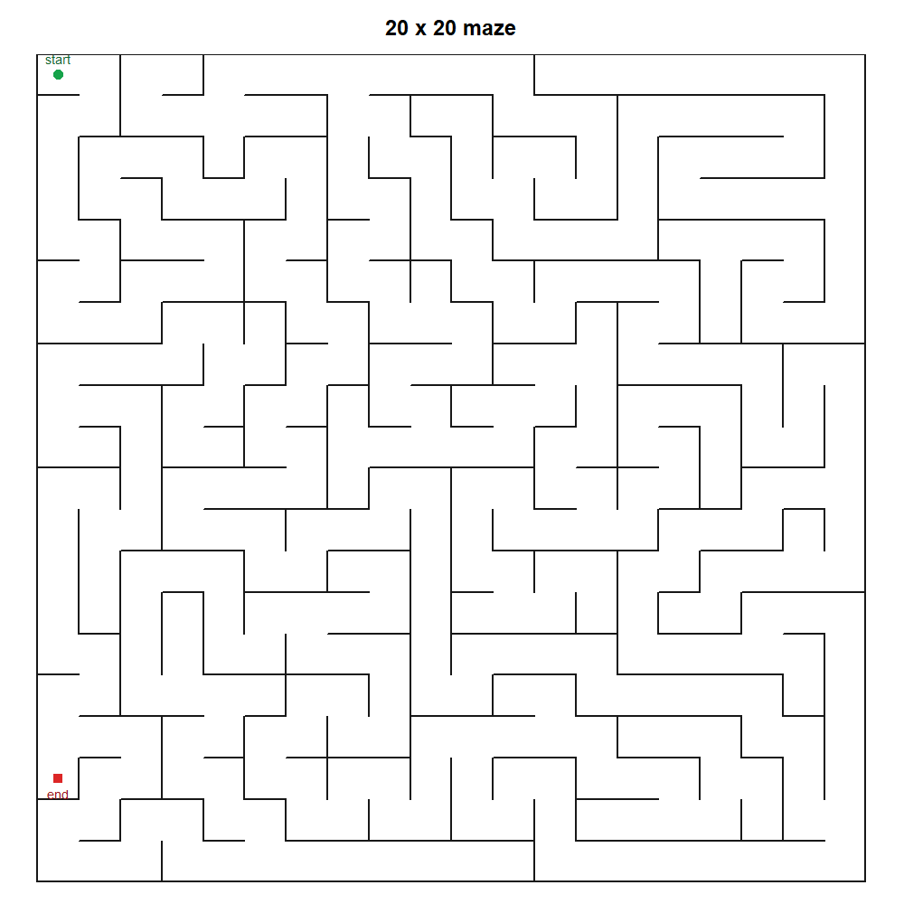
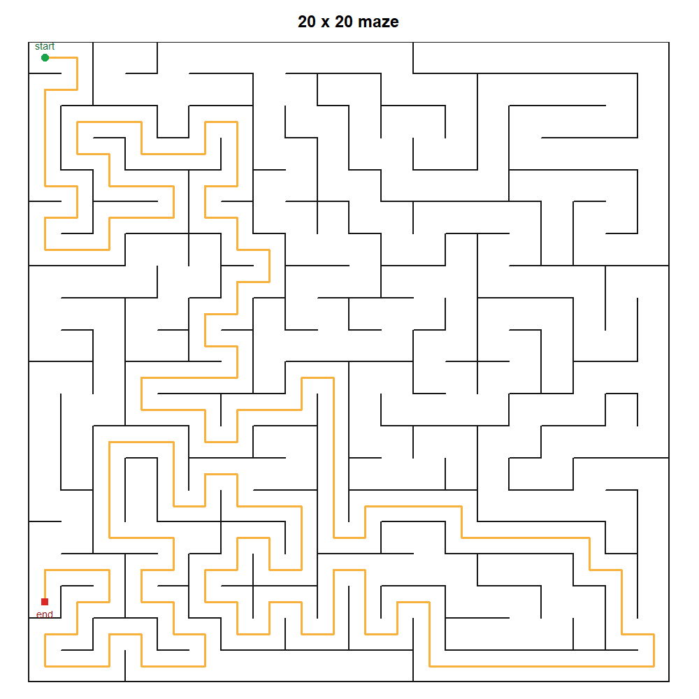

# mazegenerator

<!-- badges: start -->
[](https://github.com/matfmc/mazegenerator/actions/workflows/R-CMD-check.yaml)
[](https://matfmc.github.io/mazegenerator/)
[](LICENSE.md)
<!-- badges: end -->

**mazegenerator** is a small educational R package for generating, visualizing,
animating, and solving rectangular mazes. It implements five generation
algorithms — randomized depth-first search, Prim, Kruskal, Wilson, and Eller —
and three pathfinding algorithms — A-star, Dijkstra, and breadth-first search —
so their behaviour can be compared side by side.



## Installation

Install the development version from GitHub:

```r
install.packages("remotes")
remotes::install_github("matfmc/mazegenerator")
```

The core package uses only base R. Animated GIF export additionally requires
[`magick`](https://docs.ropensci.org/magick/):

```r
install.packages("magick")
```

## Generate and plot a maze

```r
library(mazegenerator)

maze <- generate_maze(rows = 20, cols = 20, seed = 99)
plot_maze(maze)
```



Generation is reproducible when `seed` is supplied. The returned `maze` object
contains the passages carved between cells and `carve_order`, the order in
which they were opened. Pick a different algorithm with `algorithm`:

```r
plot_maze(generate_maze(20, 20, seed = 99, algorithm = "prim"))
```

Each algorithm leaves a recognisable texture: depth-first search produces long
winding corridors, Prim and Kruskal produce short bushy dead ends, Wilson draws
uniformly from every possible maze, and Eller works one row at a time in
constant memory.

## Solve it

```r
path <- solve_maze(maze)
plot_maze(maze, solution = path)
```



All three search algorithms return a shortest route; what differs is how much
of the maze they expand to find it. `trace = TRUE` records every expansion:

```r
maze <- generate_maze(40, 40, seed = 123, algorithm = "kruskal")

vapply(c("astar", "dijkstra", "bfs"), function(algo) {
  length(attr(solve_maze(maze, algorithm = algo, trace = TRUE), "search_trace")$steps)
}, integer(1))
#>    astar dijkstra      bfs
#>     1303     1600     1600
```

`solve_maze()` can also find a path through a numeric or logical matrix:

```r
board <- matrix(
  c(1, 1, 0, 0,
    0, 1, 1, 0,
    0, 0, 1, 1,
    0, 0, 0, 1),
  nrow = 4,
  byrow = TRUE
)

solve_maze(board, start = c(1, 1), end = c(4, 4))
```

## Animate the generation

```r
small_maze <- generate_maze(12, 12, seed = 7)
animate_maze(small_maze, "maze-animation.gif", fps = 12)
```

For a large maze, use `every` to render fewer frames:

```r
animate_maze(maze, "maze-animation.gif", every = 4)
```

## How it works

The generator starts in one cell and repeatedly chooses a random unvisited
neighbor. When it reaches a dead end, it backtracks until another unvisited
neighbor is available. This produces a *perfect maze*: all cells are connected
and there is exactly one simple path between any two cells.

See the [algorithm article](https://matfmc.github.io/mazegenerator/articles/how-it-works.html)
for a visual explanation and the complete reproducible example.

## License

MIT © 2026 Matheus. See [LICENSE.md](LICENSE.md).
